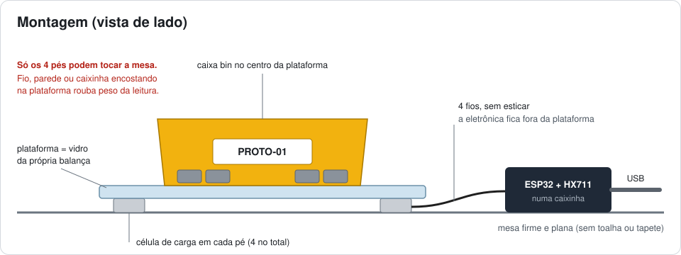

# Montagem da caixa inteligente (PROTO-01)

Este guia mostra como transformar uma balança de banheiro, um HX711 e um ESP32 numa **caixa que conta as próprias peças** e manda a quantidade para o [gêmeo digital do almoxarifado](https://bliss-vital.github.io/gemeo-digital-almoxarifado/).

**Como funciona:** as células de carga sentem o peso da caixa. O HX711 transforma esse sinal em número, e o ESP32 converte o número em gramas. Depois o ESP32 manda a leitura pelo cabo USB ou pela internet, e o painel divide o peso pelo peso de uma peça para chegar na quantidade.

Tempo estimado: 2 a 3 horas.


---

## 0. Teste rápido: só a ESP32, antes de montar o circuito

Dá para testar a conexão com o gêmeo digital só com a ESP32 e o cabo USB, sem HX711 e sem balança. O código é o mesmo da caixa, então não precisa trocar nada depois.

1. Prepare a Arduino IDE (passo 5) e grave o `esp32_balanca.ino` com o seu Wi-Fi (passo 6).
2. Abra o painel: **https://bliss-vital.github.io/gemeo-digital-almoxarifado/#proto&caixa=ufabc-almox-g5**. Ou, no cartão PROTO-01, clique em **Wi-Fi**, digite `ufabc-almox-g5` e clique em **Conectar**. Se preferir pelo cabo, feche o Monitor Serial e clique em **USB**.
3. O selo fica verde (**Ao vivo**) e o cartão mostra "balança não ligada". Isso é o normal sem o circuito.
4. **Aperte o botão BOOT da ESP32** (o botão ao lado do conector USB; o outro é o EN, que reinicia). No painel aparecem:
   - o aviso "Sinal recebido: botão BOOT da ESP32 apertado" no alto da tela;
   - a faixa "Sinal do botão BOOT · 1×" no cartão PROTO-01, com o horário;
   - o letreiro "BOOT" em cima da caixa PROTO-01 no 3D.
5. **Teste no outro sentido:** clique em **Tarar** no painel. O LED azul da placa pisca quando o comando chega.

**O LED azul da placa** fica aceso quando a ESP32 está conectada na internet. Ele pisca a cada toque no BOOT e a cada comando que chega do painel. Algumas placas não têm esse LED; nelas o teste funciona igual, só sem a luz.

Se o selo não ficar verde, veja a tabela de problemas (passo 13). Os mais comuns são rede de 5 GHz e rede eduroam.

---

## 1. Materiais

| Item | Qtd. | Observação |
|---|---|---|
| ESP32 DevKit (módulo ESP32-WROOM-32, 30 ou 38 pinos) | 1 | O código usa os pinos GPIO 16 e GPIO 4 |
| Módulo HX711 (placa verde com VCC, SCK, DT, GND) | 1 | |
| Balança de banheiro digital | 1 | Vamos usar as 4 células de carga e o vidro. A plaquinha original (TB-400V20) sai |
| Cabo USB **de dados** (micro-USB ou USB-C, conforme a placa) | 1 | Cabo só de carga não grava o código |
| Fios jumper ou fios finos | ~8 | |
| Caixa bin (organizador plástico) | 1 | É a caixa PROTO-01 |
| Peças iguais para guardar na caixa | 10 ou mais | Quanto mais pesada cada peça, mais exata a contagem. Ideal: 50 g ou mais por peça |
| Peso conhecido para calibrar | 1 | Ex.: pacote fechado de 1 kg de arroz ou açúcar |
| Carregador USB 5 V ou power bank (opcional) | 1 | Para a caixa funcionar longe do computador |
| Caixinha, fita dupla face e abraçadeiras (opcional) | — | Para proteger e prender a eletrônica |

**Ferramentas:** ferro de solda e estanho, alicate de corte e descascador, fita isolante ou termo-retrátil e chave Phillips. Um multímetro é opcional, mas ajuda a conferir os fios.

---

## 2. Preparar a balança

1. **Tire as pilhas** da balança.
2. **Abra a balança** pelos parafusos de baixo. Não solte as 4 células de carga: elas ficam presas nos pés, nos cantos, e devem continuar lá.
3. **Ache a placa TB-400V20**, a dos botões ON / UNIT / TARE. Na borda de baixo ela tem os pontos **V+, V−, E−, E+, S−, S+**.
4. **Fotografe a placa antes de mexer** para saber qual cor está em qual ponto. Na nossa balança:

   | Ponto na placa | Cor do fio | Vai para |
   |---|---|---|
   | E+ | vermelho | HX711 **E+** |
   | E− | preto | HX711 **E−** |
   | S+ | verde | HX711 **A+** |
   | S− | branco | HX711 **A−** |
   | V+ / V− | vermelho e azul (da pilha) | **não usar** |

   > Se a sua balança tiver outras cores, vale o que está **escrito na placa** (E+, E−, S+, S−), não a cor.

5. **Dessolde os 4 fios** E+, E−, S+, S− da placa. Se for cortar, corte rente à placa. Descasque uns 3 mm de cada ponta e passe estanho.
6. A placa original e o visor não serão mais usados.

**Teste opcional com multímetro (escala de Ω):** meça entre E+ e E− e depois entre S+ e S−. Os dois valores devem ser parecidos, em geral perto de 1 kΩ. Se aparecer "OL" (aberto), algum fio está solto.

---

## 3. Ligar as células no HX711

Solde os 4 fios nos furos do HX711 que ficam do lado **E+ E− A− A+ B− B+**:

| Fio da balança | Pino do HX711 |
|---|---|
| E+ (vermelho) | **E+** |
| E− (preto) | **E−** |
| S+ (verde) | **A+** |
| S− (branco) | **A−** |

Os pinos **B+ e B− ficam vazios**, porque o código usa só o canal A, que tem o ganho maior. Se o seu HX711 veio sem os pinos soldados no lado VCC / SCK / DT / GND, solde uma barra de pinos ali.

---

## 4. Ligar o HX711 no ESP32

| HX711 | ESP32 | Na placa de 30 pinos aparece como |
|---|---|---|
| VCC | **3V3** | 3V3 |
| GND | **GND** | GND |
| DT | **GPIO 16** | RX2 |
| SCK | **GPIO 4** | D4 |

> ⚠️ **Ligue o VCC no 3V3, nunca no 5V/VIN.** Os pinos do ESP32 trabalham com 3,3 V, e um HX711 alimentado com 5 V manda 5 V no pino DT.

Se a sua placa for **ESP32-WROVER**, o GPIO 16 fica ocupado pela memória da placa. Nesse caso, ligue o DT no **GPIO 18** e mude `PINO_DT` para `18` no código.

---

## 5. Preparar o computador (só na primeira vez)

1. **Instale a Arduino IDE 2** em <https://www.arduino.cc/en/software>. Se já tiver, pule este passo.
2. **Adicione as placas ESP32**:
   - Em **Arquivo → Preferências**, no campo **URLs adicionais do Gerenciador de Placas**, cole:
     ```
     https://espressif.github.io/arduino-esp32/package_esp32_index.json
     ```
   - Em **Ferramentas → Placa → Gerenciador de Placas**, procure **esp32** e instale **"esp32" da Espressif Systems**.
3. **Instale as bibliotecas** em **Ferramentas → Gerenciar Bibliotecas**:
   - **HX711 Arduino Library**, de *Bogdan Necula*;
   - **PubSubClient**, de *Nick O'Leary*.
4. **Driver USB:** ligue o ESP32 no computador. Se nenhuma porta COM aparecer em **Ferramentas → Porta**, instale o driver do chip USB da sua placa (está escrito no chip perto do conector):
   - **CP2102 / CP210x:** driver "CP210x USB to UART Bridge" da Silicon Labs;
   - **CH340:** driver "CH341SER" da WCH.

---

## 6. Configurar e gravar o código

1. Abra **`esp32_balanca/esp32_balanca.ino`** na Arduino IDE.
2. No topo do código, em `CONFIGURAÇÃO`, coloque a rede Wi-Fi:
   ```cpp
   const char* WIFI_SSID  = "NOME_DA_SUA_REDE";
   const char* WIFI_SENHA = "SENHA_DA_SUA_REDE";
   ```
   - Precisa ser uma rede de **2,4 GHz com internet**, porque o ESP32 não conecta em 5 GHz. O roteador do celular funciona bem; no Android e no iPhone, ative a opção de compatibilidade ou 2,4 GHz.
   - Redes da universidade com login e senha pessoal (**eduroam**) **não funcionam**. Use o roteador do celular.
   - Dá para pular este passo e configurar a rede depois pelo Monitor Serial (passo 7).
3. O **código da caixa** é `CANAL = "ufabc-almox-g5"`. É ele que se digita no painel para ver a caixa pela internet. Se trocar aqui, digite o mesmo código no painel.
4. Em **Ferramentas**, escolha:
   - **Placa:** ESP32 Dev Module;
   - **Porta:** a COM que apareceu quando você ligou o ESP32.
5. Clique em **Carregar** (a seta →).
   - Se ficar parado em `Connecting........_____`, **segure o botão BOOT** da placa até aparecer `Writing at ...` e solte.
6. Espere aparecer **"Hard resetting via RTS pin..."**. Isso quer dizer que a gravação deu certo.

---

## 7. Primeiro teste no Monitor Serial

1. Abra **Ferramentas → Monitor Serial**. Configure **115200 baud** e o final de linha **Nova linha**.
2. Aperte o botão **EN** (ou RST) da placa. Deve aparecer algo assim:
   ```
   # Caixa inteligente PROTO-01 iniciando
   # Tara feita: caixa vazia = 0 g
   # ATENCAO: balanca ainda nao calibrada. Coloque um peso conhecido e envie c<gramas>, ex.: c500
   # Conectando ao Wi-Fi "MinhaRede"......
   # Wi-Fi conectado em "MinhaRede". IP 192.168.0.23
   # Caixa PROTO-01 | HX711 ok | fator 1.0000 (sem calibrar)
   # Internet ok. No painel: Wi-Fi -> codigo "ufabc-almox-g5"
   {"id":"PROTO-01","peso_g":3.0,"estavel":true,"botao":0,"ip":"192.168.0.23","uptime_s":3}
   ```
   Sem o HX711 ligado, aparece `HX711 nao respondeu` e o JSON traz `"sensor":false`. A conexão e o botão BOOT funcionam do mesmo jeito.
3. **Aperte a plataforma com a mão.** O `peso_g` precisa mudar bastante. Antes de calibrar, o número não está em gramas e pode até ficar negativo, o que é normal.
4. **Rede pelo Monitor Serial** (sem regravar o código). Envie:
   ```
   w NOME DA REDE|SENHA
   ```
   O ESP32 salva a rede e reinicia. Envie só `w` para apagar a rede salva.
5. Envie `i` a qualquer momento para ver a rede, o IP, se a internet está conectada, a calibração e o item.

Se aparecer `ERRO: HX711 nao respondeu`, confira o passo 4 e a tabela de problemas no final.

---

## 8. Montagem final



1. **Feche a balança** com as 4 células nos pés e o vidro (a plataforma) por cima, como era antes. Passe os 4 fios para fora por uma fresta ou furo.
2. **Apoie a balança numa mesa firme e plana.** Toalha, tapete ou pé torto deixam a leitura instável.
3. **Coloque a caixa bin no centro da plataforma.** Se quiser, prenda com fita dupla face; a tara desconta o peso da caixa.
4. **Prenda a eletrônica fora da plataforma**, numa caixinha ao lado. Os fios devem ficar soltos, sem esticar.
5. **Nada pode encostar na plataforma** além dos 4 pés. Um fio, uma parede ou a caixinha encostando "rouba" peso e a contagem erra.
6. Ligue o cabo USB no computador, para usar a conexão USB, ou num carregador de celular, para usar a internet.

---

## 9. Tara e calibração (uma vez só)

Faça com a montagem final pronta, pelo Monitor Serial:

1. **Tara.** Deixe a caixa bin **vazia** em cima da plataforma e envie:
   ```
   t
   ```
   Resposta: `# Tara feita: caixa vazia = 0 g`.
2. **Calibração.** Coloque o peso conhecido dentro da caixa (ex.: pacote de 1 kg), espere 2 segundos e envie o valor em gramas:
   ```
   c1000
   ```
   Resposta: `# Calibrado com 1000 g: fator = ... (salvo)`. O número do fator muda de balança para balança.
3. **Confira:**
   - com o pacote dentro, `peso_g` fica perto de 1000;
   - com a caixa vazia, fica perto de 0;
   - teste com outro objeto de peso conhecido, se tiver.

A tara e a calibração **ficam salvas** no ESP32. Só refaça se mudar a montagem ou trocar a caixa.

---

## 10. Conectar no gêmeo digital

Abra o painel: **https://bliss-vital.github.io/gemeo-digital-almoxarifado/**. O cartão **PROTO-01** fica à direita.

### Opção A: cabo USB (mais simples)
1. **Feche o Monitor Serial** da Arduino IDE. A porta só pode ser usada por um programa de cada vez.
2. Use **Google Chrome ou Microsoft Edge**.
3. No cartão, clique em **USB** e escolha a porta do ESP32 (aparece como CP210x, USB-SERIAL CH340 ou parecido).
4. O selo fica verde: **Ao vivo · USB**.

### Opção B: pela internet (Wi-Fi), de qualquer lugar
1. Ligue a caixa em qualquer carregador USB. O ESP32 precisa estar numa rede com internet (passo 6 ou 7).
2. No cartão, clique em **Wi-Fi**, digite o código **`ufabc-almox-g5`** e clique em **Conectar**.
3. O selo fica verde: **Ao vivo · Internet**.

Funciona no link publicado, em qualquer computador ou celular, mesmo em outra rede. Para mostrar na feira, gere um QR Code deste link, que já abre conectado na caixa:
```
https://bliss-vital.github.io/gemeo-digital-almoxarifado/#proto&caixa=ufabc-almox-g5
```

### Opção C: rede local pelo IP (sem internet)
- O ESP32 e o computador precisam estar na mesma rede. Se o ESP32 não achar rede nenhuma, ele cria a própria rede **Almoxarifado-ESP32** (senha `12345678`) e usa o IP `192.168.4.1`.
- No cartão, clique em **Wi-Fi** e digite o **IP** que aparece no Monitor Serial.
- Só funciona com o **index.html baixado e aberto pelo computador**. No link publicado (https), o navegador bloqueia o acesso direto ao IP.

---

## 11. Configurar o item e contar peças

1. No cartão PROTO-01, abra **Item da caixa e calibração**.
2. Escolha o **item**, o **mínimo**, que dispara o alerta de reposição, e a **capacidade**.
3. Com a caixa vazia, clique em **Tarar**.
4. Coloque um número conhecido de peças (ex.: 10), digite esse número e clique em **Medir peso unitário**.
5. Pronto: tire e coloque peças. Em 1 a 2 segundos a quantidade muda, a movimentação aparece na lista **Movimentações em tempo real** e a caixa muda no 3D. Abaixo do mínimo, aparece o alerta.

O item e o peso de uma peça **ficam salvos no ESP32**. Por isso, qualquer pessoa que abrir o painel em outro computador ou celular vê a mesma contagem.

---

## 12. Checklist final

- [ ] Com a caixa vazia, o `peso_g` fica perto de 0 g.
- [ ] Com o peso de 1 kg, fica perto de 1000 g (± 10 g).
- [ ] O painel mostra **Ao vivo** (USB ou Internet).
- [ ] Tirar 1 peça diminui 1 na quantidade em até 2 s, e a movimentação aparece na lista.
- [ ] Abaixo do mínimo, aparece o alerta de reposição.
- [ ] Desligar a caixa faz o painel mostrar **Sem sinal** em uns 5 s.
- [ ] Pela internet, o painel abre no celular com o link do QR Code.

---

## 13. Problemas comuns

| Problema | O que fazer |
|---|---|
| Nenhuma porta COM aparece | Troque o cabo (pode ser só de carga) e instale o driver CP210x ou CH340 (passo 5) |
| A gravação para em `Connecting...` | Segure o botão **BOOT** durante a gravação |
| `ERRO: HX711 nao respondeu` | Confira VCC no 3V3, GND, DT no GPIO 16 e SCK no GPIO 4. DT e SCK trocados é o erro mais comum. Confira também as soldas |
| O peso não muda quando aperta a plataforma | Fios E+/E−/A+/A− soltos ou trocados. Meça com o multímetro (passo 2) |
| O peso fica pulando e nunca fica "estável" | Algo encostando na plataforma, mesa torta, fio mal soldado ou vento. Se continuar, aumente `LIMIAR_ESTAVEL_G` no código (ex.: 15) |
| `Nao percebi o peso` ao calibrar | O peso não estava na caixa, ou os fios S+/S− (A+/A−) estão soltos |
| O peso fica negativo | A tara foi feita com algo dentro da caixa. Esvazie e envie `t` |
| A contagem erra por 1 ou 2 peças | Meça o peso unitário com mais peças (ex.: 20). Peças muito leves (menos de ~20 g) ficam imprecisas numa célula de balança de banheiro |
| Não conecta no Wi-Fi | A rede precisa ser de 2,4 GHz. Confira a senha (`w REDE\|SENHA`). eduroam não funciona: use o roteador do celular |
| `Sem acesso a broker.hivemq.com` | A rede bloqueia a porta 1883 (algumas redes de empresa ou faculdade fazem isso). Use o roteador do celular |
| O painel fica em "Conectando…" pela internet | Confira se o código digitado é igual ao `CANAL` do código e se o Monitor Serial mostrou `Internet ok` |
| USB: "Não foi possível abrir a porta" | Feche o Monitor Serial da Arduino IDE e tente de novo |
| O power bank desliga sozinho | Alguns desligam quando o consumo é baixo. Use um carregador de tomada |

---

## 14. Como funciona (para o relatório)

```
células de carga ─► HX711 ─► ESP32 ──┬─ USB (Serial, 2 leituras/s) ─────────────► painel no Chrome/Edge
  (ponte de          (conversor      ├─ Wi-Fi ► servidor MQTT (1 leitura/s) ──► painel em qualquer lugar
   Wheatstone)        24 bits)       └─ Wi-Fi ► servidor HTTP do ESP32 ───────► painel na rede local
```

**No ESP32** (`esp32_balanca.ino`):
- lê o HX711 10 vezes por segundo e faz a média das últimas 10 leituras (1 s);
- chama a leitura de **estável** quando a variação nessa janela é menor que `LIMIAR_ESTAVEL_G`;
- converte a leitura em gramas com a tara e o fator de calibração, que ficam salvos na memória (`Preferences`);
- guarda o item, o peso de uma peça, o mínimo e a capacidade, e já calcula a quantidade;
- envia tudo em JSON:
  ```json
  {"id":"PROTO-01","peso_g":1280.4,"estavel":true,"qtd":10,"item":"ROL-6205","g_un":128.0,"min":5,"cap":20,"botao":0,"ip":"192.168.0.23","uptime_s":321}
  ```
- conta os toques no botão BOOT (`botao`) e manda a leitura na hora em que ele é apertado. O painel mostra cada número novo como um sinal, o que serve para testar a conexão.

**Pela internet:** o ESP32 publica no servidor MQTT público `broker.hivemq.com`. O painel lê pelo mesmo servidor, via WebSocket seguro.

| Tópico | Conteúdo |
|---|---|
| `gemeo-almox/ufabc-almox-g5/dados` | a leitura em JSON, a cada 1 s |
| `gemeo-almox/ufabc-almox-g5/status` | `online` ou `offline`. Se a caixa cair, o servidor publica `offline` sozinho |
| `gemeo-almox/ufabc-almox-g5/cmd` | comandos do painel: `t` (tara) e `item SKU;g;min;cap` |

**No painel** (`index.html`):
- calcula a quantidade como `peso ÷ peso de uma peça`, arredondada;
- só aceita uma quantidade nova depois que ela fica parada por 1,2 s (ou 2,5 s se a leitura não estiver estável), para não contar movimento no meio de uma retirada;
- registra cada mudança como retirada ou reposição, atualiza o 3D e gera o alerta quando a quantidade fica abaixo do mínimo.

---

## 15. Cuidados

- O servidor MQTT é **público e gratuito**, bom para demonstração. Quem souber o código da caixa consegue ver as leituras, tarar e trocar o item, mas não consegue mudar a calibração nem o Wi-Fi, que só mudam pelo cabo USB.
- Para uso real, troque `CANAL` por um código só seu ou use um servidor MQTT privado com usuário e senha.
- A célula de balança de banheiro é feita para até ~150 kg. Para peças leves, uma célula menor (de 1 kg a 5 kg) dá uma contagem bem mais precisa, usando o mesmo HX711 e o mesmo código.
