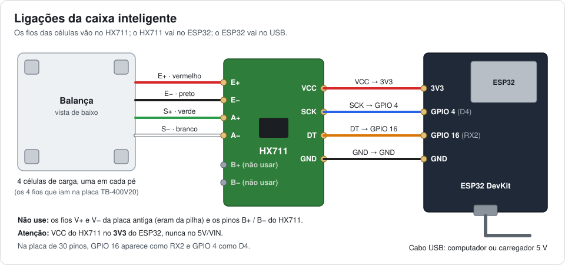

# Gêmeo Digital · Almoxarifado

Gêmeo digital 3D de um almoxarifado fictício, com 8 estantes e 2.352 posições de caixas bin. Uma das caixas, a **PROTO-01**, é real: ela fica sobre uma célula de carga ligada a um ESP32 + HX711 e atualiza o estoque sozinha. A quantidade é calculada pelo peso (peso medido ÷ peso de uma peça). As outras posições aparecem vazias e sem sensor: indicadores, alertas e movimentações mostram só os dados reais da PROTO-01, sem nenhuma simulação.

**Abrir no navegador:** https://bliss-vital.github.io/gemeo-digital-almoxarifado/

> Projeto da disciplina Inovações para Engenharia (UFABC, 3Q.2026).

## O que dá para fazer

- Navegar pelo almoxarifado em 3D: arrastar para girar, botão direito para mover, roda para zoom e WASD para andar.
- **Corredores**: andar entre as estantes na altura dos olhos.
  - Segure ↑ para andar (Shift corre).
  - ← e → viram para a estante da esquerda ou da direita.
  - Q e E trocam de corredor.
  - De frente para a estante, as setas passam de caixa em caixa (← →) e de nível em nível (↑ ↓). Espaço vira para a estante do outro lado e Esc volta a olhar o corredor.
  - Uma planta pequena mostra onde você está. Clique nela para ir até lá.
- **Planta 2D**: navegar sem o 3D.
  - Em cima fica a planta das estantes vista de cima. A cor mostra os módulos com alerta.
  - Embaixo fica a frente da estante escolhida, com a quantidade de cada caixa.
  - As teclas são as mesmas. Enter abre a caixa no 3D.
- As estantes têm placas de endereço em cada módulo (ex.: `C-05`), iguais aos códigos das caixas (`C-05-4-2` = estante C, módulo 05, nível 4, posição 2).
- Clicar numa caixa para ver item, quantidade, mínimo, valor e o histórico da quantidade.
- Acompanhar indicadores, alertas de reposição e as movimentações em tempo real.
- Buscar por item ou endereço (ex.: `rolamento`, `C-05`).
- Trocar as cores das caixas entre **Realista**, **Status** (OK / abaixo do mínimo / sem estoque) e **Ocupação**.
- Conectar a caixa protótipo por **USB**, pela **internet** (Wi‑Fi, de qualquer lugar, até pelo celular) ou usar o modo **Demonstração**, que funciona sem hardware.

Atalhos pelo endereço:
- `index.html#proto` vai direto para a caixa protótipo.
- `index.html#proto&demo` já abre no modo demonstração.
- `index.html#proto&caixa=ufabc-almox-g5` já abre conectado na caixa real, pela internet. Bom para um QR Code.
- `index.html#corredor` começa andando no corredor.
- `index.html#2d` abre a Planta 2D.

## Caixa protótipo (ESP32 + HX711)

**Passo a passo completo da montagem, da gravação e da calibração: [MONTAGEM.md](MONTAGEM.md).**



Resumo:
1. Ligue as células no HX711 (E+, E−, S+ → A+, S− → A−) e o HX711 no ESP32 (VCC → 3V3, GND → GND, DT → GPIO 16, SCK → GPIO 4).
2. Na Arduino IDE (placa **ESP32 Dev Module**), instale as bibliotecas **HX711 Arduino Library** (Bogdan Necula) e **PubSubClient** (Nick O'Leary).
3. Coloque o Wi‑Fi no topo de `esp32_balanca/esp32_balanca.ino` e grave o código.
4. Pelo Monitor Serial (115200): envie `t` com a caixa vazia e depois `c1000` com 1 kg dentro da caixa.
5. No painel, clique em **USB** (Chrome ou Edge) ou em **Wi‑Fi** e digite o código da caixa `ufabc-almox-g5`.

**Como a caixa conversa com o painel**
- **USB:** o ESP32 manda uma linha JSON a cada 500 ms pela porta serial (Web Serial no Chrome/Edge).
- **Internet:** o ESP32 publica a leitura a cada 1 s no servidor MQTT público `broker.hivemq.com`, no tópico `gemeo-almox/ufabc-almox-g5/dados`. O painel lê pelo WebSocket seguro do mesmo servidor, então funciona no link publicado e em qualquer rede.
- **Rede local por IP:** `http://<IP>/dados`. Só funciona com o `index.html` baixado no computador; no link publicado (https), o navegador bloqueia o acesso direto ao IP.
- A caixa guarda o item e o peso de uma peça. Quem abrir o painel em outro computador vê a mesma contagem.
- Células de balança de banheiro não medem bem coisas leves. Use peças de pelo menos uns 50 g por unidade.

## Estrutura

```
index.html                        painel 3D (Three.js r128, sem instalação)
lib/                              Three.js e OrbitControls (funciona offline)
logo.js                           logo da startup (PNG embutido), pintado no piso em frente às estantes
esp32_balanca/esp32_balanca.ino   firmware do ESP32 + HX711
MONTAGEM.md                       passo a passo da montagem da caixa
docs/                             diagramas de ligação e de montagem
```
